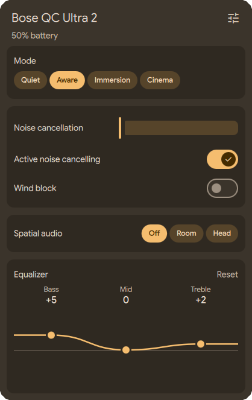
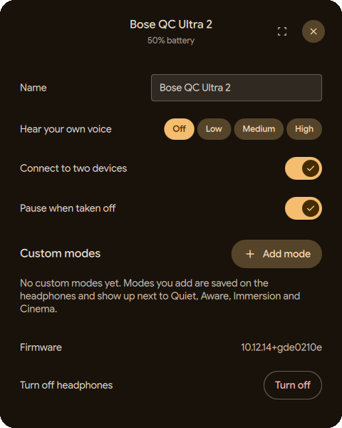

# Bose Headphones for DMS

A Dux Modular Shell (DMS) bar plugin for Bose headphones, built on the [bosectl](https://github.com/aaronsb/bosectl) library. No Bose app, no cloud.

<p>
  
  
</p>

- **Bar:** headphones icon with the headset's battery. Dimmed when no headset is connected.
- **Popout:** mode (presets and custom modes), noise cancellation, active noise cancelling, wind block, spatial audio and the three-band EQ.
- **Device settings window** (tune icon in the popout header): name, sidetone, multipoint, auto-pause, firmware and turn off.
- **Custom modes** (in the settings window): add, edit and delete your own modes (noise cancellation, ANC, wind block, spatial audio). They are stored on the headphones and show up as chips next to the presets.
- Chips show a spinner until the headset confirms a change, then a check mark.

## How it works

`bose-helper.py` holds the one control connection to the headset; the headset accepts only one at a time, so quit bosectl-qt or the Bose CLI while the plugin runs. The helper reads JSON commands on stdin and writes the headset's state as one JSON line on stdout. It connects when a Bose headset is connected over Bluetooth, polls every 30 seconds and retries every 10 seconds while none is connected.

`BoseService.qml` runs the helper and shares its state with the bar widget and the window.

## Install

```bash
git clone --recurse-submodules -b dms-plugin https://github.com/TurboSjaantje/dms-bose.git ~/programming/personal/dms-bose
ln -sfn ~/programming/personal/dms-bose ~/.config/DankMaterialShell/plugins/boseHeadphones
dms ipc call plugins enable boseHeadphones
```

Then add "Bose Headphones" to a bar in the bar's widget editor.

Requires `python3` and `bluetoothctl`. Only tested with the QuietComfort Ultra Headphones (2nd Gen).

## License

MIT, see [LICENSE](LICENSE). The bosectl library in `lib/bosectl` has its own MIT license.
